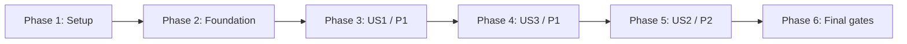

# Tasks: Page Speaker — Read Article Aloud

**Input**: Design documents from `specs/001-read-article-aloud/`.

**Prerequisites**: [plan.md](plan.md), [spec.md](spec.md), [research.md](research.md),
[data-model.md](data-model.md), [contracts/messages.md](contracts/messages.md), and
[quickstart.md](quickstart.md). The approved activation and voice decisions are final.

**Verification**: Strict TypeScript checks, production builds, and manual Chrome checks only.
The user's explicit exclusion of automated tests/frameworks overrides constitution Principle VII
and its automated-testing gate for this MVP. Add no automated tests, test runner, or test framework.

**Organization**: Tasks are grouped by user story and ordered by real dependencies. User Story 3
is P1, so it precedes User Story 2 (P2). Its paused-state checks finish after US2 supplies Pause/Resume.

**Status**: Implementation and build are ready for user verification. Thirty code/build/documentation tasks are complete; T017, T024, T030, and T034 remain unchecked pending manual Chrome checks.

## Format: `[ID] [P?] [Story] Description`

- Each task has a sequential ID; [X] means complete and [ ] means pending.
- `[P]` identifies work that can overlap another ready task in different files, once its
  stated prerequisites are complete; it does not bypass dependencies.
- `[US1]`, `[US3]`, and `[US2]` preserve the story numbers from the specification.
- Exact repository-relative paths identify implementation or validation artifacts.
- Quoted data constraints are taken from data-model.md; implement their full surrounding
  invariants and the protocol in contracts/messages.md, not just the quoted fragments.

## Path Conventions

Single extension project: `src/content/` for webpage interaction, `src/background/` for
speech/lifecycle, `src/ui/` for React controls, `src/shared/` for types and segmentation,
`public/manifest.json` for MV3, and generated `dist/` for loading in Chrome.
Feature documentation lives in `specs/001-read-article-aloud/`. Do not create a tests directory.

## Phase 1: Setup (Shared Infrastructure)

**Purpose**: Establish the requested toolchain, minimal UI components, strict checking, and
deterministic extension packaging. T001 precedes the independent T002/T003/T004 group; T005
joins that work. This phase does not start webpage interaction.

- [X] T001 Initialize the single Vite/React/TypeScript project in `package.json` and `package-lock.json`, with React/React DOM, Vite and its React plugin, Tailwind and its Vite plugin, Chrome/React/Node types, and only the helpers required by the two planned shadcn components; create the planned `src/` directories and ignore `dist/` and `node_modules/` in `.gitignore`. Add no automated-test dependencies or extra application features.

- [X] T002 [P] Configure `tsconfig.json`, `tsconfig.content.json`, `tsconfig.background.json`, and `tsconfig.node.json` for strict application/configuration checks, content/UI DOM types, worker code, and Node tooling; keep shared modules free of runtime/DOM dependencies and fix type errors without `any` or type suppressions. Depends on T001.

- [X] T003 [P] Create `public/manifest.json` for MV3 and Chrome 120+, with module worker `background.js`, an action without a default popup, and exactly `activeTab`, `scripting`, `tts`, `webNavigation`; add no static content-script matches, persistent host access, storage permission, or web-accessible resources. Depends on T001.

- [X] T004 [P] Configure `components.json`, copy only the shadcn Button and Native Select components into `src/ui/components/button.tsx` and `src/ui/components/native-select.tsx`, and establish Tailwind/theme CSS in `src/ui/styles.css`; place theme variables on `:host`, initialize used shadow-root CSS variables, and keep all styles local. Use dependencies already selected in T001 so this task does not modify the package files. Depends on T001.

- [X] T005 Configure `vite.config.ts` and `package.json` scripts for `npm run typecheck` and sequential `npm run build` outputs: one bundled `dist/content.js` IIFE with CSS imported as an inline string, then `dist/background.js` as an ES module. Use current Vite `rolldownOptions`, fixed filenames and no code splitting; only the first build empties `dist/` and copies `public/manifest.json`. Package all runtime dependencies locally without a dev server or extension bundler plugin. Depends on T002–T004.

**Checkpoint**: Project/configuration scaffolding is specified in executable form; the runtime entry points are added in Phase 2 before the first build validation.

---

## Phase 2: Foundational (Blocking Prerequisites)

**Purpose**: Provide the typed transport, trusted source boundary, and isolated content mount.
Complete T006, then T007/T008 in parallel, then T009. Story work begins only after T009.

- [X] T006 Define protocol-v1 discriminated message/reply/state types and explicit runtime guards in `src/shared/messages.ts` from `specs/001-read-article-aloud/contracts/messages.md`, including START/control/cancellation/invalidation/recovery messages and all rejection codes. Enforce unique request IDs and worker/session/source-epoch fields; state is “Starting, Playing, or Paused while active” plus Stopped/Finished/Error and handshake-only Idle; rate is “One of 0.5, 0.75, 1, 1.25, 1.5, 1.75, 2; initially 1”; error code/message and extensionId are optional only where documented. Depends on T005.

- [X] T007 [P] Define SourceBinding in `src/background/source-lifecycle.ts` and the live connection registry/dispatch boundary in `src/background/index.ts`; send WELCOME on `page-speaker:v1` and validate browser sender metadata. Enforce tabId as “Browser-supplied integer identifying the source tab”, frameId as “Must be 0; frames are unsupported”, documentId as “Browser-issued document identifier, not a payload claim”, sourceEpoch as “Worker-issued integer; changes when this document's route or article root is invalidated”, articleUrl as “Transient browser-derived URL without a fragment; used only for navigation comparison”, port as “Runtime connection scoped to this injected document”, and connected as “False immediately invalidates pending/active work belonging to the connection”. Retain only live bindings. Depends on T006.

- [X] T008 [P] Implement one guarded Shadow DOM host and React mount/unmount boundary in `src/content/shadow-root.ts`, inserting only the inline compiled `src/ui/styles.css` inside it; isolate typography, sizing and box sizing, preserve webpage styles, expose viewport-clamped action/panel containers, and provide cleanup without adding portals or document-wide styles. Depends on T006 and T004.

- [X] T009 Create `src/content/index.tsx` as an idempotent bootstrap with the Shadow DOM mount and typed Port client; wait for WELCOME, track workerId/sourceEpoch, correlate request replies, and reject obsolete session/revision updates. Keep the idle mount hidden, expose start/control subscriptions for the story integrations, and register no page postMessage or external messaging bridge. Depends on T007–T008.

**Checkpoint**: Shared interfaces and isolated content/worker boundaries are ready; no story depends on an unimplemented transport.

---

## Phase 3: User Story 1 — Read from a chosen point (Priority: P1)

**Goal**: Toolbar-enable one document, select article text, and read from that exact occurrence
through the remaining article using a local voice, with a basic status/Stop display.

**Independent manual criteria**: On five representative article layouts, the action appears
only after activation and a valid selection; speech starts at the selected occurrence,
continues past the selection, excludes unrelated text, and rejects bad/stale starts clearly.
The action appears within 1 second and suitable local speech within 5 seconds.
Use M1 selection/activation, M2, and M3 from quickstart.md. This is the first runnable slice;
the complete personal-use MVP also requires US3 safety and US2 controls.

### Implementation for User Story 1

- [X] T010 [P] [US1] Implement SelectionBookmark capture, validation and action positioning in `src/content/selection.ts`: retain “start/end node references, raw UTF-16 offsets, saved selected text”, rectangles and source epoch; “The saved Range is in document order” even for backward selections. Require non-whitespace text and connected unchanged endpoints; ignore editable fields, frames and extension UI. Accept/return native Range boundaries without importing the article extractor; preserve the bookmark during control focus/pointer interaction, replace it on genuine selection changes, and discard it on clear, invalidation, request acceptance/rejection or unmount. Depends on T009.

- [X] T011 [P] [US1] Implement conservative article identification and original-DOM extraction in `src/content/article.ts`, accepting native Range plus expected selection text and source epoch independently of `selection.ts`. SourceSpan retains “original Text node identity, raw start/end offsets, containing block” and its ordered traversal position; ArticleSnapshot retains “source epoch, root identity, normalized article suffix, and language hint.” Enforce “non-whitespace text, connected unchanged endpoints, a non-editable main-document selection, and a wholly contained eligible article region.” Resolve element-boundary starts, clip before whitespace normalization, preserve formatted words/block separators, exclude identifiable navigation/ads/sidebars/hidden/editable/frame/UI content while retaining below-the-fold text, and reject ambiguous/stale starts with the documented local errors. Never use text search, a reparsed clone or whole-body fallback. Depends on T009.

- [X] T012 [P] [US1] Implement pure sentence segmentation in `src/shared/speech-segments.ts` using Intl.Segmenter. Enforce index as “Zero-based utterance order”, start/end as “Half-open UTF-16 interval in the normalized suffix”, text as “Exactly the suffix slice for that interval; never HTML supplied for rendering”, and the “500-code-unit cap”; split oversized sentences at word boundaries, use safe Unicode boundaries for unbroken tokens, and enforce “Do not split a surrogate pair.” Attach whitespace to neighboring segments and cover the full suffix without truncation, omissions or overlap. Depends on T009.

- [X] T013 [US1] Add LocalVoice discovery/selection to `src/background/playback.ts`: require “non-empty voiceName”, “optional extensionId”, “compatible language”, “remote fixed to false”, and “start/end support”; reject unknown locality/capabilities and selectors that also match remote/unclassified voices. Prefer exact then base language, use English for the unlabeled acceptance baseline, choose deterministically, pin the identity, and recheck before each utterance. Reject with NO_LOCAL_VOICE before replacing current playback; never drop the selector or fall back to remote/default speech. Depends on T006–T007.

- [X] T014 [US1] Implement the base PendingStart/ReadingSession controller and sequential TTS loop in `src/background/playback.ts`, using the data-model fields for source/epoch, workerId/sessionId, cancellation generation, ordered segments/index, utteranceToken, pinned voice, requestedRate/utteranceRate, pauseIntent, revision and lifetimeTimer. Use “Starting, Playing, or Paused while active” and a “Monotonic state revision for the session”; enforce “There is at most one active session across tabs and one in-flight utterance.” At rate 1, preflight before acceptance, submit one segment with enqueue false, publish Playing only on start, advance once only on end, and implement Stop/Finished/basic Error with token invalidation and text release. Depends on T012–T013.

- [X] T015 [US1] Wire toolbar activation and START/STOP dispatch in `src/background/index.ts`: inject packaged `content.js` into frame 0 only after the action click, reuse an existing mount, never auto-start speech, and show a clear action badge/title on prohibited pages/PDFs. Route source-local requests and replies to the controller; a new/reloaded document requires another activation. Depends on T009 and T014.

- [X] T016 [US1] Connect selection, extraction, START and the status/Stop display in `src/content/index.tsx` and `src/ui/ReaderControls.tsx`; render the labeled “Read from here” action near the saved selection, read only the resulting suffix, and show local extraction/rejection errors without mutating existing playback. Keep selection snapshots valid through pointer/keyboard activation and drop transient request text after acceptance/rejection. Expose accessible Starting/Playing/Stopped/Finished/Error status and a Stop action for this first runnable slice; Pause/Resume/speed are completed in US2. Depends on T010–T015.

- [ ] T017 [US1] Run `npm run typecheck` and `npm run build` from `package.json`, load `dist/manifest.json` through Chrome Load unpacked, and manually verify the activation/selection portions of M1 and all extraction/bookmark cases in M2–M3 of `specs/001-read-article-aloud/quickstart.md` on the five article layouts. Confirm exact repeated/backward/partial/inline/multi-paragraph starts, exclusion/refusal, <=1-second action visibility and <=5-second local-voice start; record content-free pass/fail/not-exercised results there. Navigation/replacement/error-lifetime cases follow in US3; full controls follow in US2. Depends on T016.

**Checkpoint (pending T017)**: Demonstrate the core reading slice manually. Complete US3 and US2 before treating it as the full MVP.

---

## Phase 4: User Story 3 — End safely and understand failures (Priority: P1)

**Goal**: Keep one current session, stop source-invalidated speech, handle worker/voice errors,
and release text without retaining history.

**Independent manual criteria**: Using the US1 flow without requiring the full US2 panel,
verify that valid cross-tab starts replace old speech, rejected requests preserve it, full/
same-document article navigation ends it, fragment jumps/tab switching do not, local-only
failures are clear, and forced worker loss cannot replay a session. Run Starting/Playing
M5–M6 now. Paused variants are an explicit later integration check in T030.

### Implementation for User Story 3

- [X] T018 [P] [US3] Complete pending-start ordering, cancellation and atomic cross-tab replacement in `src/background/playback.ts` and `src/background/index.ts`; enforce “There is at most one current pending start.” Newer START supersedes older pending work without stopping accepted speech; recheck browser document/route, source epoch, connection and generation after asynchronous preflight. Implement CANCEL_START, source/session ownership, idempotent STOP, duplicate request protection and stale-message rejection; notify the replaced source and prevent obsolete callbacks from advancing or overwriting new state. Depends on T017.

- [X] T019 [P] [US3] Implement source lifecycle observers in `src/background/source-lifecycle.ts` using the stable SourceBinding and controller invalidation interface: top-frame beforeNavigate/committed/historyStateUpdated, tab removal/replacement, and Port loss terminate owned pending/active work. Compare browser documentId and fragment-free URL; path/query changes advance sourceEpoch and emit SOURCE_RESET, while fragment-only jumps, unrelated tabs/subframes and tab switching leave playback alone. Export registration/invalidation hooks for integration in T022. Depends on T017.

- [X] T020 [P] [US3] Add content-side pagehide/article-root invalidation and SOURCE_RESET handling to `src/content/index.tsx`: send INVALIDATE_SOURCE best effort, clear old bookmarks/request data, and observe root removal/replacement without treating ordinary appended article text as a route change. Keep the frozen reading suffix and same-document activation rules; a departing document cannot be restored by a late response. Do not duplicate background navigation authority or patch the page's History API. Depends on T017.

- [X] T021 [US3] Add session-only worker lifetime handling and speech watchdogs in `src/background/playback.ts`: lifetimeTimer is “Session-scoped worker lifetime extension, cleared at termination”; call a trivial extension API about every 20 seconds only during Starting/Playing/Paused. Enforce the contract's 5-second start timeout and 120-second active-speech segment watchdog, suspend progress accounting during native pauses, and clear all timers on terminal paths. Map API/engine/voice loss and unexpected interruption/cancellation to sanitized Error; ignore deliberately invalidated callbacks. Depends on T018.

- [X] T022 [US3] Integrate lifecycle hooks and worker recovery in `src/background/index.ts` and `src/content/index.tsx`: register listeners synchronously, issue a fresh workerId and cancel orphaned speech before accepting work, handle RECOVER_CONNECTION/RECOVERED using browser sender plus exact old-session ownership, and reconnect a live source without replaying text. Show SESSION_INTERRUPTED only for a lost active session; idle reconnection stays quiet and stale cleanup cannot stop newer/other-tab playback. Depends on T019–T021.

- [X] T023 [US3] Audit and complete terminal cleanup in `src/background/playback.ts`, `src/content/index.tsx`, and `src/ui/ReaderControls.tsx`: after Stopped/Finished/Error preserve only the current source-local panel identifier, “terminal status, displayed rate, revision, and optional sanitized error code/message.” Clear text, bookmarks, cursor/index, timers and pending continuations; retain only live connection/route metadata and never accumulate sessions, raw engine errors or reading history. Keep rejected requests distinct from failures of accepted playback and never resume a terminal session. Depends on T022.

- [ ] T024 [US3] Rebuild the changed extension using `package.json`, then manually run the Starting/Playing, cross-tab replacement, invalid-request preservation, navigation/fragment/root-removal, local-only/unknown/ambiguous/removed-voice, timeout and forced-worker-recovery cases from M5–M6 in `specs/001-read-article-aloud/quickstart.md`; include >5-minute reading/background-tab checks with DevTools closed. Record actual results there without content/history. Paused variants and long-pause verification are explicitly deferred to T030 because Pause/Resume belongs to US2. Depends on T023.

**Checkpoint (pending T024)**: Verify Starting/Playing safety cases; retain the Paused integration checks for T030.

---

## Phase 5: User Story 2 — Control listening while scrolling (Priority: P2)

**Goal**: Complete native Pause/Resume, Stop, seven speed choices, and accessible floating controls.

**Independent manual criteria**: From a running US1/US3 session, pause/resume at the native
position, change rate by the next sentence without skips or unwanted resume, stop within
1 second, and operate all controls by keyboard while scrolling. Verify all seven speeds,
long pauses, and the deferred Paused lifecycle/recovery cases through M4–M6.

### Implementation for User Story 2

- [X] T025 [P] [US2] Implement native PAUSE/RESUME and paused Stop/state transitions in `src/background/playback.ts`: enforce “Pause is enabled only while Playing, Resume only while Paused, Stop in all active states” and pauseIntent “Prevents scheduling another utterance while paused”. Retain the native in-utterance position, handle between-segment pause/end races without advancing twice, and resume either the native utterance or the next unsent segment; do not estimate/store a cursor or cancel/restart to emulate pause. Apply the existing timeout/lifetime semantics to pauses. Depends on T024.

- [X] T026 [US2] Implement SET_RATE behavior in `src/background/playback.ts`: requestedRate is “One of 0.5, 0.75, 1, 1.25, 1.5, 1.75, 2; initially 1” and utteranceRate is “Rate used for the in-flight native utterance”. Accept changes only while Playing/Paused, apply by the next segment without skipping text, keep paused sessions paused and their native current utterance unchanged, and reset new sessions to 1. Depends on T025.

- [X] T027 [P] [US2] Complete the presentational panel in `src/ui/ReaderControls.tsx` with labeled shadcn Pause, Resume, Stop and Native Select speed controls, the seven allowed values, state-based disabled actions, visible focus, and accessible status/error announcements. Use the finalized protocol/model from T006 and existing UI components without changing playback or content transport files, allowing work alongside T025–T026. Depends on T024.

- [X] T028 [US2] Wire panel callbacks and authoritative state/rate updates in `src/content/index.tsx` to PAUSE/RESUME/STOP/SET_RATE messages, preserve worker/session/source identity, and keep local request errors separate from the current session status. Changing a selection alone must not interrupt playback; controls must not destroy a saved selection needed for a fresh START. Depends on T026–T027.

- [X] T029 [US2] Finish viewport-fixed responsive layout and keyboard/style isolation in `src/ui/styles.css` and `src/content/shadow-root.ts`: keep the complete panel and selection action inside the visible window during scroll/resize/zoom, make every control reachable without a focus trap or unwanted focus stealing, and verify scoped typography/focus/border/ring variables against unusual webpage root sizes. Use no body-level CSS or portaled controls. Depends on T028.

- [ ] T030 [US2] Run `npm run typecheck` and `npm run build` from `package.json`, reload in Chrome, then manually verify M4 and the deferred Paused variants of M5–M6 in `specs/001-read-article-aloud/quickstart.md`: native position, <=1-second Pause/Stop, every speed, paused rate changes, keyboard-only flow, scroll/zoom, >5-minute pause/resume with DevTools closed, navigation/replacement while paused, and interrupted-session recovery. Record results there; rerun earlier scenarios only when changed behavior or a defect warrants it. Depends on T029.

**Checkpoint (pending T030)**: All three stories are implemented; manually verify controls and Paused safety cases against the current build.

---

## Phase 6: Polish & Cross-Cutting Concerns

**Purpose**: Finish reproducible local instructions, review permissions/privacy, and obtain
the final strict-typecheck, production-build, and manual Chrome evidence. These are required
MVP completion gates rather than optional enhancements.

- [X] T031 [P] Write `README.md` with the implemented prerequisites, `npm ci`, `npm run typecheck`, `npm run build`, `dist/` output, Chrome Load unpacked and rebuild/reload/re-enable steps, toolbar/selection/control usage, local-voice failure recovery, all four permission rationales, privacy and unsupported-content limits. Keep commands consistent with `package.json` and `specs/001-read-article-aloud/quickstart.md`. Depends on T030.

- [X] T032 Perform the final scope/privacy/dependency review of `public/manifest.json`, `package.json`, `src/shared/messages.ts`, `src/background/playback.ts`, and `src/content/index.tsx`: remove unused permissions/dependencies, verify on-device-only selection and every terminal cleanup path, and confirm no content/history persistence, payload logging, backend, paid API or automated-test files/frameworks were introduced. Record the review result in `specs/001-read-article-aloud/quickstart.md`; fix concrete findings before final validation. Depends on T030.

- [X] T033 From a clean implemented checkout follow `README.md`: run `npm ci`, `npm run typecheck`, and `npm run build`, verify `dist/manifest.json`, `dist/content.js` and `dist/background.js` are self-contained and loadable, and fix actual type/build/package errors. Record the environment and real command results in `specs/001-read-article-aloud/quickstart.md`; do not add a test runner or treat Vite transpilation as type checking. Depends on T031–T032.

- [ ] T034 Load the final `dist/manifest.json` build in Chrome and complete M7 privacy/restart/clean-checkout checks plus one full select→read→pause→resume→speed→stop smoke flow from `specs/001-read-article-aloud/quickstart.md`. Carry forward valid M1–M6 evidence from T017/T024/T030, rerunning affected cases if final fixes changed behavior. Record content-free pass/fail/not-exercised results and any remaining environment limitations there; all required acceptance outcomes must be satisfied or explicitly reported before claiming the MVP complete. Depends on T033.

**Checkpoint (pending T034)**: Complete the final manual Chrome checks and record outcomes; do not claim completion while required cases are failing or unexercised.

---

## Dependencies & Execution Order

### Phase Dependencies

### User Story Dependencies

- **US1** depends on foundation T009. Selection, article extraction, and segmentation use
  the fixed Range/protocol/data-model boundaries and can be developed separately.
- **US3** depends on the runnable US1 slice T017. It extends the existing controller and
  source client; do not schedule entire US1 and US3 phases concurrently.
- **US2** follows US3 T024 so playback controls inherit source ownership and safe cleanup.
  Its T030 also completes the Paused safety acceptance that US3 could not exercise earlier.
- **Final gates** follow all three stories. Stop at a failed check to fix the observed issue;
  repeat only checks affected by new changes, failures, or an unresolved concern.

### Within Each User Story

Implement pure/typed data boundaries before runtime services, then integrate controls and
perform the story's manual checks against its production bundle. All task dependencies refer
to earlier IDs. Priorities do not make dependent changes safe to run concurrently.

### Parallel Opportunities

| Ready after | Tasks that may overlap | Separation / join |
| --- | --- | --- |
| T001 | T002, T003, T004 | Type configs, manifest, copied UI/CSS; join at T005 |
| T006 | T007, T008 | Background source/Port registry versus Shadow DOM mounting; join at T009 |
| T009 | T010, T011, T012 | Native-Range bookmark, native-Range extractor, pure segmentation; join before T016 |
| T017 | T018, T019, T020 | Controller/worker dispatch, lifecycle module, content invalidation; join at T022 after T021 |
| T024 | T025 and T027 | Backend pause/resume versus presentational controls; T026 follows T025, then join at T028 |
| T030 | T031 and T032 | README versus code/manifest audit; join at T033 |

T021 must wait for T018 because both change playback.ts; T022 must wait for the background/
content work it integrates. T026 is not parallel with T025 because both change playback.ts.
Manual checks and mutations to the same file are serialized. Parallel descriptions are
execution guidance only; generating this document does not launch any implementation.

## Parallel Example: User Story 1

After T009, implement T010 in `src/content/selection.ts`, T011 in
`src/content/article.ts`, and T012 in `src/shared/speech-segments.ts` together.
The selection and extraction modules communicate through native Range/primitive inputs;
neither requires the other's implementation. Complete their integration in T016 only after
all dependencies are ready.

## Parallel Example: User Story 3

After T017, T018 may extend `src/background/playback.ts` and `src/background/index.ts`
while T019 adds observers in `src/background/source-lifecycle.ts` and T020 handles
invalidation in `src/content/index.tsx`. Their interface boundary is the existing
SourceBinding and source invalidation callback. Join these changes at T022.

## Parallel Example: User Story 2

After T024, T025 can add native backend controls in `src/background/playback.ts`
while T027 completes `src/ui/ReaderControls.tsx` against the fixed protocol.
Do T026 after T025, and wire both sides in T028.

## Implementation Strategy

### MVP First

The first demonstrable slice is US1. The requested MVP includes all three stories:
accurate selection-to-end reading, safe session/source behavior, and complete playback controls.
Do not drop local-only speech, permissions, cleanup, accessibility, or Pause/Resume/speed to
declare an early slice finished. No PDFs, frames, editable reading, highlighting, automatic
scrolling, audio export, accounts, cloud features, or automated-test setup is added.

### Incremental Delivery

1. Complete Setup and Foundation without expanding the dependency set.
2. Implement US1 and validate its reading flow.
3. Implement US3 and validate Starting/Playing safety.
4. Implement US2, then validate the controls and deferred Paused safety cases.
5. Finish local documentation and final gates. Keep each task unchecked until its actual
   implementation or verification is complete; never mark unexercised Chrome checks complete.

### Parallel Team Strategy

Use only the ready-file groups in the Parallel Opportunities table. Entire user stories
share runtime files and have explicit dependencies, so they are not independent parallel
implementation streams. A single implementer can follow IDs sequentially.

## Requirement Coverage

| Requirements | Main implementation tasks | Verification tasks |
| --- | --- | --- |
| FR-001–FR-002: activation and selection | T003, T008–T010, T015–T016 | T017, T034 |
| FR-003–FR-005: exact suffix, extraction and safe refusal | T010–T014, T016, T018 | T017, T024 |
| FR-006–FR-008: floating panel and playback controls | T025–T029 | T030, T034 |
| FR-009–FR-010: session/source lifecycle | T014, T018–T022 | T024, T030 |
| FR-011–FR-012: status, errors and accessibility | T006, T016, T021–T023, T027–T029 | T017, T024, T030 |
| FR-013–FR-014: no retained content/history and local voices | T013–T014, T018, T021–T023 | T024, T032, T034 |
| FR-015–FR-017: permissions, exclusions, local instructions | T001–T005, T010–T011, T015, T031–T033 | T017, T032–T034 |

The linked quickstart maps M1–M7 to SC-001–SC-008. T017 verifies selection/start timing and
extraction; T030 verifies control timing, all speeds and viewport/keyboard behavior;
T024/T030 verify safety and local-voice failures; T033/T034 verify reproducibility and privacy.

## Notes

- **34 tasks**: 5 setup, 4 foundational, 8 US1, 7 US3, 6 US2, and 4 final gates.
- **14 parallel markers** identify six ready-file groups, not permission to ignore prerequisites.
- Manual evidence belongs in quickstart.md as environment, check IDs, pass/fail/not-exercised
  status, and content-free defect notes; do not retain selected passages or reading history.
- Automated tests/frameworks, deployment, publishing, and application implementation are
  not performed by generating this file.
